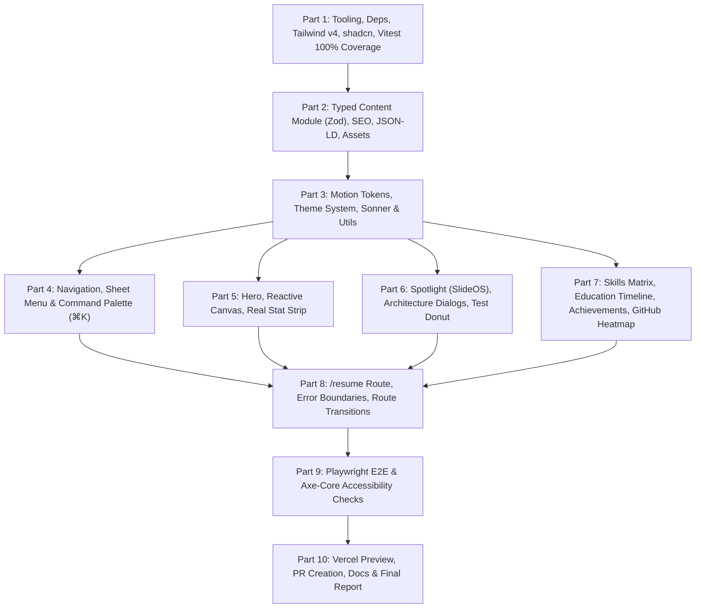

# Implementation Plan: Portfolio Upgrade (`redesign`)

**Repository:** `https://github.com/Drv4ever/Portfolio`  
**Branch:** `redesign`  
**Target:** Production-grade Next.js App Router portfolio with React 19, Tailwind CSS v4, Motion, shadcn/ui, 100% Vitest coverage, Playwright e2e, and zero-violation accessibility.

---

## Architecture & Work Breakdown

---

## Detailed Task Breakdown

### Part 1: Tooling, Dependencies, and Test Infrastructure
- [ ] Upgrade/install packages using `npm`:
  - `next@latest`, `react@19`, `react-dom@19`, `motion` (`motion/react`)
  - `tailwindcss@next` / Tailwind v4 and `@tailwindcss/postcss`
  - `zod`, `lucide-react`, `next-themes`, `sonner`, `clsx`, `tailwind-merge`
  - Dev dependencies: `vitest`, `@vitejs/plugin-react`, `jsdom`, `@testing-library/react`, `@testing-library/user-event`, `@vitest/coverage-v8`, `@playwright/test`, `@axe-core/playwright`
- [ ] Setup shadcn CLI with preset `b3PkSQ` and add components:
  - `button`, `badge`, `dialog`, `drawer`, `sheet`, `command`, `tooltip`, `dropdown-menu`, `sonner`, `scroll-area`, `chart`, `tabs`
- [ ] Configure `vitest.config.ts`:
  - Enforce **100%** thresholds for statements, branches, functions, and lines.
  - Exclude only `components/ui/**` (shadcn-generated primitives) and explicitly listed WebGL scene canvas with explanatory comment.
- [ ] Configure `next.config.ts`:
  - React compiler enabled
  - Strict security headers (CSP, HSTS, X-Content-Type-Options, Referrer-Policy, Permissions-Policy)
  - Restrict `images.remotePatterns`
- [ ] Configure scripts in `package.json`:
  - `typecheck`: `tsc --noEmit`
  - `test`: `vitest run`
  - `test:coverage`: `vitest run --coverage`
  - `test:e2e`: `playwright test`

### Part 2: Typed Content Module (Zod) & SEO Metadata
- [ ] Create `src/content/schema.ts`:
  - Zod schemas for Profile, SocialLink, Education, SkillCategory, Project, Achievement, Certification.
- [ ] Create `src/content/index.ts`:
  - Profile: Dhruv Jain, Vellore/Gwalior India, email mailto, verified socials (no phone number).
  - Education: VIT (B.Tech IT 2024–2028, CGPA 9.08), DPS Gwalior (89.2%).
  - Skills: 9 categories matching resume exactly.
  - Projects: SlideOS, MongoDB MCP Server, Cloud-Based Parcel Locker, TCRAS, Vaultify (learning).
  - Achievements: 220+ LeetCode, published patent contribution (exact text), IBM DevOps.
- [ ] Create `src/content/__tests__/content.test.ts`:
  - 100% test coverage validating schema compliance.
  - Assert that phone number `+91 9406586767` or `9406586767` does NOT appear anywhere.
- [ ] Setup SEO:
  - `src/app/sitemap.ts` and `src/app/robots.ts`
  - Dynamic OpenGraph generator `src/app/opengraph-image.tsx`
  - JSON-LD `Person` schema with `alumniOf` and `knowsAbout`.

### Part 3: Motion Tokens, Primitives, and Utility Layer
- [ ] Create `src/lib/motion.ts`:
  - Centralized motion tokens: named durations, easings, spring physics, reduced-motion fallbacks.
- [ ] Create `src/lib/utils.ts`:
  - Class merge utility `cn`.
- [ ] Unit tests for `motion.ts` and `utils.ts` achieving 100% coverage.

### Part 4: Navigation, Mobile Sheet, and ⌘K Command Palette
- [ ] Create `src/components/Navbar.tsx`:
  - Floating sticky nav, scroll progress bar, active section observer, theme toggle.
  - Mobile hamburger opening shadcn `Sheet`.
- [ ] Create `src/components/CommandPalette.tsx`:
  - shadcn `CommandDialog`, keyboard shortcut `⌘K` / `Ctrl+K`.
  - Fast search across sections, projects, live links, resume download, copy email.
- [ ] Unit tests with Testing Library simulating user events and keyboard shortcuts.

### Part 5: Hero, Signature Canvas Visual, and Stat Strip
- [ ] Create `src/components/Hero.tsx`:
  - Masked staggered name reveal.
  - Self-hosted avatar (`public/avatar.png`).
  - Magnetic hover buttons for Resume and Email.
- [ ] Create `src/components/HeroCanvas.tsx`:
  - Lightweight cursor-reactive particle constellation with static fallback on touch/reduced-motion.
- [ ] Create `src/components/StatStrip.tsx`:
  - Animated count-ups using only real numbers: 209 automated tests, 12 SlideOS themes, 220+ LeetCode, 9.08 CGPA.
- [ ] Unit tests for Hero and StatStrip.

### Part 6: SlideOS Spotlight & Featured Works Architecture Diagrams
- [ ] Create `src/components/SlideOSSpotlight.tsx`:
  - Active status badge, GitHub & Live Demo links.
  - Animated pipeline diagram: Prompt → Groq LLM (JSON) → Slide Count Enforcer / Deterministic Fallback → DND Editor → PPTX/PDF Export.
  - JWT + OAuth auth and share links description.
  - shadcn Donut chart for test distribution: 131 Vitest (Frontend) vs. 78 Jest (Backend).
- [ ] Create `src/components/ProjectCard.tsx` & `src/components/ProjectDetailDialog.tsx`:
  - 3D tilt + cursor spotlight on fine pointers.
  - Modal with shared element transition and draw-on-open SVG architecture flows:
    - MongoDB MCP Server: AI Client → MCP Server → MongoDB
    - Parcel Locker: EC2 Warden Dashboard → Core Lambda → DynamoDB + AWS Bus (SNS, SQS DLQ, EventBridge)
    - TCRAS: React → Node APIs → FastAPI → Isolation Forest → SQLite
- [ ] Create `src/components/LearningProjects.tsx` for Vaultify.
- [ ] Unit tests for all project components.

### Part 7: Skills Matrix, Education Timeline, Achievements, GitHub Heatmap, & Footer
- [ ] Create `src/components/SkillsSection.tsx`: Filterable tabs, honest badges.
- [ ] Create `src/components/EducationTimeline.tsx`: Minimal animated timeline.
- [ ] Create `src/components/AchievementsSection.tsx`: Cards for LeetCode, Patent, IBM DevOps.
- [ ] Create `src/components/GithubHeatmap.tsx`: Server component fetching `Drv4ever` activity with cache and graceful fallback.
- [ ] Create `src/components/Footer.tsx`: Copy email with Sonner toast, verified socials, back-to-top.
- [ ] Unit tests for all sections.

### Part 8: Dedicated Resume Page (`/resume`) & Route Transitions
- [ ] Update `src/app/resume/page.tsx`:
  - Embedded inline PDF viewer serving `/Dhruv-Jain-Resume.pdf`.
  - Prominent download button and iOS fallback.
- [ ] Setup error boundaries: `error.tsx`, `global-error.tsx`, `not-found.tsx`.
- [ ] Configure View Transitions / Motion route transition.
- [ ] Unit tests for Resume page and Error boundaries.

### Part 9: End-to-End Tests & Accessibility Budget
- [ ] Setup Playwright configuration with Chromium, Firefox, WebKit, and Mobile Chrome viewports.
- [ ] Write tests verifying:
  - Navigation, command palette, project modals, skills filtering, theme toggle, copy email, resume download, reduced-motion behavior.
  - `@axe-core/playwright` accessibility check with zero violations on all routes.

### Part 10: Verification, Pull Request & Report
- [ ] Run full check: `npm run typecheck && npm run lint && npm run test:coverage && npm run build`.
- [ ] Ensure 100% coverage threshold is enforced and met.
- [ ] Push branch `redesign` to origin.
- [ ] Open Pull Request using `gh pr create`.
- [ ] Verify Vercel preview deployment.
- [ ] Capture before and after screenshots into `docs/`.
- [ ] Update `README.md`.
- [ ] Provide final comprehensive report.
