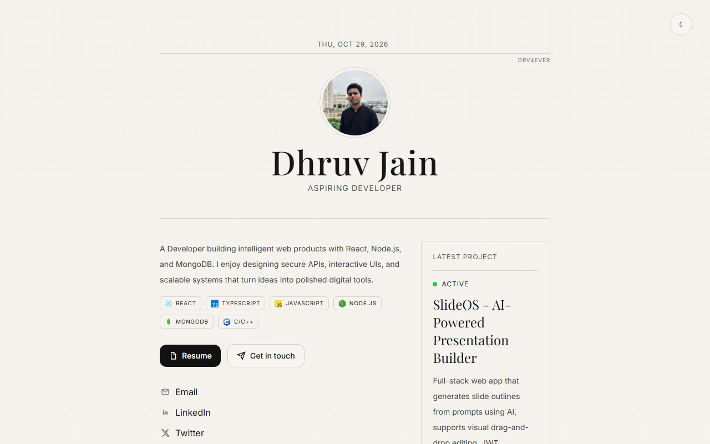
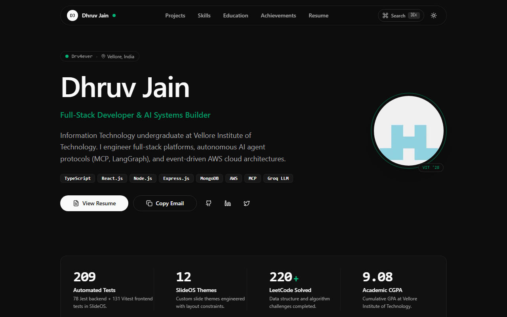
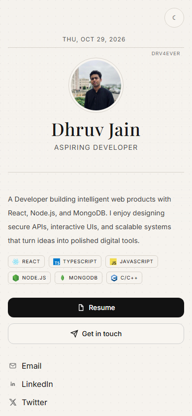
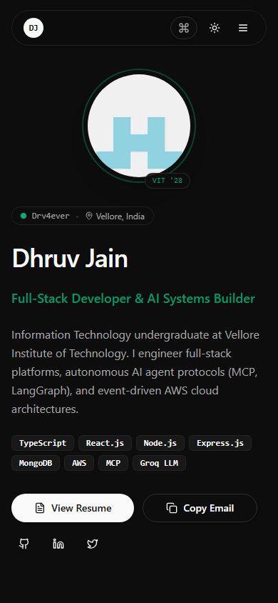

# Dhruv Jain — Technical Editorial Portfolio

A high-craft, modern personal portfolio engineered with a **Technical Editorial** aesthetic, purposeful motion, verified data visualizations, strict build-time content validation, and 100% test coverage.

Deployed on Vercel at [drv-dev.vercel.app](https://drv-dev.vercel.app/).

---

## 📸 Visual Comparison

| Before Redesign | After Redesign |
| :--- | :--- |
|  |  |
|  |  |

---

## 🛠️ Architecture & Tech Stack

- **Framework:** [Next.js 16 (App Router)](https://nextjs.org/) with React 19 & React Compiler (`babel-plugin-react-compiler`)
- **Styling:** [Tailwind CSS v4](https://tailwindcss.com/) with OKLCH theme variables and typography styling
- **Components & Primitives:** [shadcn/ui](https://ui.shadcn.com/) (Button, Badge, Dialog, Drawer, Sheet, Tooltip, Command, Sonner, ScrollArea, Chart, Tabs)
- **Animation & Motion:** [Motion (`motion/react`)](https://motion.dev/) orchestrated via centralized motion design tokens (`src/lib/motion.ts`)
- **Data Visualizations:** Recharts (SlideOS test split donut) and dynamic SVG Architecture Schematics
- **Schema Validation:** [Zod](https://zod.dev/) for typed, build-time validated single-source content
- **Testing:**
  - [Vitest](https://vitest.dev/) + React Testing Library + v8 coverage: **100% lines, branches, functions, statements**
  - [Playwright](https://playwright.dev/) for cross-browser desktop & mobile E2E automation
  - [@axe-core/playwright](https://github.com/dequelabs/axe-core-npm/tree/develop/packages/playwright) for automated WCAG accessibility audits (0 violations)

---

## 🔑 Environment Variables

Create a `.env.local` file in the project root:

```bash
# Optional: GitHub Personal Access Token (classic with public_repo read or fine-grained read-only)
# Used server-side to fetch verified public commit contributions from GraphQL API for @Drv4ever.
# If omitted or failed, the heatmap degrades gracefully without breaking the layout.
GITHUB_TOKEN=ghp_your_token_here
```

> [!NOTE]
> The GitHub token is strictly accessed server-side inside `src/components/GithubHeatmap.tsx` and is never bundled or exposed to the client browser.

---

## 🚀 Available Scripts

In PowerShell or your preferred shell:

```powershell
# Development server with hot reload
npm run dev

# TypeScript type checking (strict mode)
npm run typecheck

# ESLint inspection
npm run lint

# Production build with Turbopack & static page generation
npm run build

# Start local production server
npm run start

# Unit & Component test suite (Vitest)
npm run test

# Enforced 100% test coverage report (fails if any metric is below 100%)
npm run test:coverage

# Playwright End-to-End suite (Desktop & Mobile Chrome + Axe accessibility audits)
npm run test:e2e
```

---

## 📁 Adding or Updating a Project (One-File Change)

All portfolio content is decoupled from UI components and resides in `src/content/index.ts`, strictly validated against `src/content/schema.ts` at build time.

To add a new project, simply append an entry to `rawContent.projects` in `src/content/index.ts`:

```typescript
{
  id: "your-project-id",
  title: "Project Title",
  tagline: "One-line technical summary",
  description: "Detailed description of system architecture and outcomes.",
  category: "featured", // "spotlight" | "featured" | "learning"
  techStack: ["TypeScript", "Next.js", "Docker"],
  bullets: [
    "Key engineering achievement with real verifiable metrics.",
    "Architectural decisions, throughput, or performance optimizations.",
  ],
  github: "https://github.com/Drv4ever/your-repo",
  live: "https://your-demo.vercel.app", // Optional
  hasCustomDiagram: false, // Set to true if adding an SVG diagram
}
```

Because `content` is the single source of truth across the application:
1. It automatically appears in the Featured Projects grid.
2. It is indexed in the ⌘K / Ctrl+K Command Palette.
3. It creates interactive modal detail views with fine-pointer tilt and spotlight.
4. Its skills and technologies are included in SEO JSON-LD `Person` metadata.
5. Zod schema validation will fail fast at build time if any required field is missing or invalid.

---

## 🔒 Security & Privacy Guarantees

- **Phone Number Privacy:** Dhruv Jain's phone number is never committed or published. Email is exposed only via `mailto:` and an interactive clipboard copy button.
- **Content Integrity:** All claims, numbers, and stats match `AI-Resume3.pdf` exactly (209 automated tests, 12 SlideOS themes, 220+ LeetCode problems, CGPA 9.08).
- **Security Headers:** Strict Content Security Policy (`CSP`), `X-Frame-Options: DENY`, `X-Content-Type-Options: nosniff`, and `Referrer-Policy: strict-origin-when-cross-origin` are enforced in `next.config.ts`.
